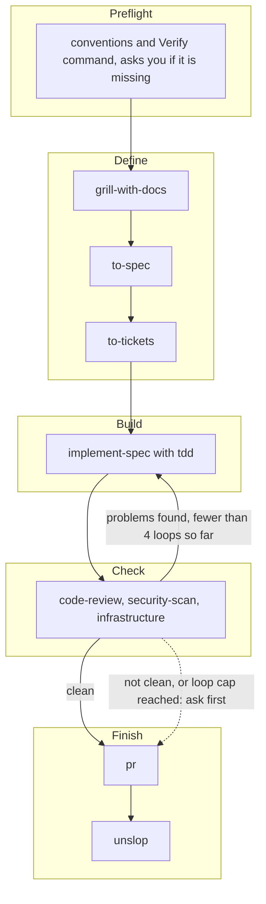

# TDS Factory

TDS Factory is a small software factory. It installs a set of skills into Claude, Codex and Copilot, and one of those skills, `factory`, walks a piece of work from idea to pull request.

**New here?** Read the [install guide](docs/install.md) to set the Factory up, then the [usage guide](docs/usage.md) to run your first piece of work. Run `tds-factory doctor` in a project first: it checks, without changing anything, whether the project is ready for a Run.

## Setup

You need Node 20 or newer. Install the latest Release and its skills with one line.

macOS and Linux:

```sh
curl -fsSL https://github.com/TDSchreur/tds-factory/releases/latest/download/install.sh | sh
```

Windows (PowerShell):

```powershell
powershell -c "irm https://github.com/TDSchreur/tds-factory/releases/latest/download/install.ps1 | iex"
```

Each script checks Node and npm, installs the Release with npm and runs `tds-factory install`. Run the same line again to update. To read before you run, download the script and open it, or run the two commands yourself, the same on macOS, Linux and Windows:

```sh
npm install -g --allow-remote=root https://github.com/TDSchreur/tds-factory/releases/latest/download/tds-factory.tgz
tds-factory install
```

The `--allow-remote=root` flag is needed because npm 12 refuses URL installs by default. `tds-factory --version` shows the installed version. Skills are not installed automatically by `npm install`; `tds-factory install` does that, and it has to run again after every update, because the installed `factory` Skill must use the same Run commands as the CLI. `tds-factory update` and the one-line scripts do both steps for you.

To update, run `tds-factory update`. It installs the latest Release when yours is older, checks the download against the Release's checksum, and then runs `tds-factory install --force`, which replaces agent files and skills you edited with the defaults, and any skill folder of the same name that `tds-factory` did not install. Use `tds-factory update --no-force` to keep them. The one-line scripts keep them too; set `TDS_FACTORY_FORCE=1` to replace them, or `TDS_FACTORY_SKIP_SKILLS=1` to install only the CLI. Maintainers publish Releases manually; see the [release guide](docs/releasing.md). To work on the Factory itself, see the [development guide](docs/development.md). Install options (`--agent`, `--project`, `--force`, `--dry-run`) are in the [install guide](docs/install.md).

## The flow

A Run is one pass through four Stages, after a Preflight (`tds-factory doctor` runs its checks). Start it with the `factory` skill (`/factory`).



Each Stage's result: Define writes a Spec in `docs/specs/` and a Ticket per task in the project's Issue tracker; Build finishes every Ticket test-first, one commit each, building what the Ticket asks and naming any smaller option in one line in `build.md`; Check gives a Standards, a Spec, a Security and an Infrastructure verdict (Infrastructure is skipped when no infrastructure file changed), each from a fresh read-only subagent; Finish opens the pull request.

The rules for each Stage live in [`skills/factory/SKILL.md`](skills/factory/SKILL.md). In short: only a clean Check goes on to Finish without asking, and Check sends the Run back to Build at most four times.

Agents need `tds-factory` on PATH to create and update the Run record (`run.json`, in `.factory/runs/<id>/`, plus a Markdown summary per Stage). Every Run works in its own Run worktree in `.factory/worktrees/<run id>`, on a branch named after the Run id, cut from the freshly fetched default branch of `origin`, so agents in separate tabs never share files. Run records always live in the main checkout, so one Dashboard shows every Run. Dependencies are not installed for you: run the project's normal setup in the worktree.

Default models per Stage and what each Agent target can guarantee are in the [capability matrix](docs/capabilities.md). To see whether an agent follows the Flow, run the on-demand [agent evaluation](docs/evaluation.md).

## Dashboard

`tds-factory dashboard` serves every Run of the repository on 127.0.0.1, one card per Run in a column per Stage. See the [Dashboard guide](docs/dashboard.md) for what it shows, which routes it serves and how a Run is deleted.

Add `.factory/` to the `.gitignore` of any project you run the factory in.

## Skills

The skills come from four upstream sources.

- [mattpocock/skills](https://github.com/mattpocock/skills)
- [backnotprop/pstack](https://github.com/backnotprop/pstack/tree/main/skills/unslop), which provides `unslop`
- [github/awesome-copilot](https://github.com/github/awesome-copilot/tree/main/skills/security-review), which provides `security-scan` (its `security-review` skill, renamed)

The upstream repos are git submodules in `vendor/`. `skills/` holds committed copies of the skills the factory uses, so a change upstream shows up in a diff before it reaches you. See `docs/adr/0001-committed-skill-copies.md`.

## Known limitations

- The installer copies skills unchanged. Codex ignores the Claude-only `disable-model-invocation` frontmatter, so Codex may invoke user-only skills such as `factory` on its own.

## License

MIT, see [LICENSE](LICENSE). The skills come from other MIT projects; their notices are in [THIRD-PARTY-NOTICES.md](THIRD-PARTY-NOTICES.md).

## Documentation

- [Install guide](docs/install.md): set the Factory up and prepare a project.
- [Usage guide](docs/usage.md): run a piece of work from idea to pull request.
- [Dashboard guide](docs/dashboard.md): the page that shows every Run.
- [Capability matrix](docs/capabilities.md): what each Agent target guarantees.
- [Agent evaluation](docs/evaluation.md): test an agent against the Flow.
- [Development guide](docs/development.md): work on the Factory itself from a checkout.
- [Release guide](docs/releasing.md): how maintainers publish a Release.
- [`GLOSSARY.md`](GLOSSARY.md): the terms used here (Run, Stage, Spec, Ticket and others).
- [`docs/adr/`](docs/adr/): design decisions.
