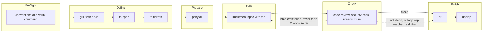

# TDS Factory

TDS Factory is a small software factory. It installs a set of skills into Claude, Codex and Copilot, and one of those skills, `factory`, walks a piece of work from idea to pull request.

It is inspired by [zazencodes software-factory-claude-code](https://github.com/zazencodes/zazencodes-season-3/tree/main/src/software-factory-claude-code) and [super-board](https://github.com/EricTechPro/super-board).

## The flow

A Run is one pass through five Stages, after a Preflight. Start it with the `factory` skill (`/factory`).



| Stage | Skills | Claude | Codex | Copilot | Result |
|---|---|---|---|---|---|
| Define | `grill-with-docs`, `to-spec`, `to-tickets` | Sonnet, default | `gpt-6.1-sol`, medium | `claude-sonnet-4.6`, not set | A Spec in `docs/specs/` and a Ticket per task in the project's Issue tracker |
| Prepare | `ponytail` | Sonnet, default | `gpt-6.1-sol`, medium | `claude-sonnet-4.6`, not set | Build writes the minimum code that works |
| Build | `implement-spec`, `tdd` | Sonnet, default | `gpt-6.1-terra`, medium | `gpt-5.3-codex`, not set | Every Ticket done, test-first |
| Check | `code-review`, `security-scan`, plus the Infrastructure review | Opus, high | `gpt-6.1-sol`, high | `claude-sonnet-4.6`, not set | A Standards, a Spec, a Security and an Infrastructure verdict |
| Finish | `pr`, `unslop` | Haiku, default | `gpt-6-luna`, medium | `claude-haiku-4.5`, not set | A prepared pull request |

Each cell is the model and its reasoning effort. "Default" means the agent definition sets no effort, so the session's own setting applies; "not set" means the Copilot target has no effort setting in its agent definition. The model columns show the defaults set in the `factory-define`, `factory-build`, `factory-check` and `factory-finish` agent definitions of each Agent target: `~/.claude/agents`, `~/.codex/agents` and `~/.copilot/agents`. Define and Prepare share `factory-define`. The installer does not ship these definitions yet, so they exist only where someone created them. Making them configurable per target is tracked in issue #32.

Preflight first checks that `/setup-matt-pocock-skills` has been run, then reads the project's conventions (`AGENTS.md` or `CLAUDE.md`, the instruction guides it routes to and the canonical specs it lists) and finds the verify command in its `## Commands` section. If there is none, it tells you, asks once and never guesses. Build refuses to start until the Spec exists and the Tickets are published, and sends the Run back to Define if either is missing. Build runs the verify command after each Ticket; a command that cannot run in the environment (another shell, no container runtime) is listed under "Not run" in the Stage summary, never reported as passed. Check gives the Standards review the guides whose `applyTo` globs match the changed files and flags a canonical spec left stale, and gives the Security review the project's "Universal safeguards". Check runs every axis on every Run; an axis with no verdict is run again.

Check sends the Run back to Build at most twice, for `code-review` problems worth fixing or any CRITICAL, HIGH or MEDIUM security or infrastructure finding. The Infrastructure axis runs only when the diff changes Bicep, Azure Pipelines or `bicepconfig.json` files, otherwise it is `skipped`. It runs `bicep build` and `bicep lint`, checks pipeline YAML for plaintext secrets, unpinned versions and missing approval gates on production stages, and never deploys. A what-if runs only when Azure credentials and a target exist, and is reported as not run otherwise. If it cannot validate a file it says "not validated" and records `fail`, never `pass`. Only a clean Check (every axis `pass`, Infrastructure possibly `skipped`) continues to Finish without asking. If any axis is `fail`, or the loop cap is reached with problems open, the skill reports what is still open and asks for permission to continue to Finish; a yes is recorded in `finish.md`, and a no ends the Run as `abandoned`. The skill never pushes or opens the PR without your go-ahead.

Build works on a branch named after the Run, one commit per Ticket, and runs inline. Check runs each review in a fresh read-only subagent, so the reviewer did not write the code. Finish saves the PR draft as `pr.md` in the Run folder, and fills in the project's PR template (`.github/`, `.azuredevops/` or `docs/pull_request_template.md`) when there is one, including its Infrastructure checklist (from the Infrastructure verdict) and its Documentation checklist (from the stale-spec check). When the tracker is GitHub the body closes every Ticket with `Closes #N`; otherwise it lists the Ticket paths and has no `Closes` lines.

The Factory requires `tds-factory` on PATH: agents use `tds-factory run start --data '<JSON>'` and `tds-factory run update --id <id> --data '<JSON>'` to create and update records. Updates validate changed fields and replace the record safely; the Dashboard reads older records tolerantly. Each Run keeps a `run.json` record in `.factory/runs/<id>/`, plus a short Markdown summary per Stage. The Run store owns these files and the Dashboard reads them through it. Besides the verdicts (`standards`, `spec`, `security`, `infrastructure`), `run.json` holds `commands` (the verify command) and `conventions` (the paths Preflight read).

## Setup

You need Node 20 or newer. After cloning, run `./setup.sh` (or `powershell -ExecutionPolicy Bypass -File .\setup.ps1` on Windows) to put the CLI on PATH (it runs `npm install -g .` and checks Node 20+), then run `tds-factory install` to install the skills. Clone with `--recurse-submodules`, or run `git submodule update --init` afterwards.

```sh
node bin/tds-factory.js sync       # copy the skills in skills.manifest.json from vendor/ into skills/
node bin/tds-factory.js install    # install skills/ into ~/.claude/skills and ~/.agents/skills
node bin/tds-factory.js dashboard  # serve the Runs of ./.factory on http://127.0.0.1:4317
```

`sync` refuses a manifest entry whose shipped name is not lowercase letters, digits and hyphens, whose source or destination leaves the repository or `skills/`, or is the repository root or inside `skills/`, or whose source is or sits under a symlink, or whose skill folder contains one, or that ships under the same name as an earlier entry. It validates every entry before it writes any.

Run the tests with `npm test`. They use `node:test`.

### Install options

| Option | Effect |
|---|---|
| `--agent claude\|codex\|copilot\|all` | Pick the Agent target. `all` is the default and means Claude plus Codex, because Copilot reads both directories. |
| `--project` | Install into the current directory instead of the user-global directory. |
| `--force` | Overwrite skill folders that tds-factory did not install. |

| Agent | Project directory | Global directory |
|---|---|---|
| claude | `.claude/skills` | `~/.claude/skills` |
| codex | `.agents/skills` | `~/.agents/skills` |
| copilot | `.github/skills` | `~/.copilot/skills` |

After you change a skill in `skills/`, run `install` again so the installed copy matches. `install` also removes folders it installed earlier that are no longer in `skills/` (it prints a `removed` line for each) and never touches folders without the tds-factory marker.

## Dashboard

`dashboard` serves the `.factory/` folder of the current directory on 127.0.0.1 and can delete completed or abandoned Runs after confirmation. The default port is 4317, and `--port` changes it. It prints the URL when it starts.

| Route | Returns |
|---|---|
| `/` | The Dashboard page, with a card per Run in a column per Stage. Runs waiting on you are flagged. Check cards show a chip per verdict: Standards, Spec, Security and Infrastructure. |
| `/api/views` | Run records interpreted for the Dashboard. |
| `/api/runs` | A JSON list of Run records. A record that cannot be read comes back with `unreadable: true`. |
| `/files/<run-id>/<name>.md` | A Markdown file from a Run folder. |

Add `.factory/` to the `.gitignore` of any project you run the factory in.

## Skills

The skills come from three upstream sources.

- [mattpocock/skills](https://github.com/mattpocock/skills)
- [DietrichGebert/ponytail](https://github.com/DietrichGebert/ponytail)
- [backnotprop/pstack](https://github.com/backnotprop/pstack/tree/main/skills/unslop), which provides `unslop`

The upstream repos are git submodules in `vendor/`. `skills/` holds committed copies of the skills the factory uses, so a change upstream shows up in a diff before it reaches you. See `docs/adr/0001-committed-skill-copies.md`.

## Known limitations

- The installer copies skills unchanged. Codex ignores the Claude-only `disable-model-invocation` frontmatter, so Codex may invoke user-only skills such as `factory` on its own.
- From ponytail, the installer copies only `SKILL.md`. Its hooks and slash commands are not installed.

## More

`GLOSSARY.md` defines the terms used here (Run, Stage, Spec, Ticket and others). Design decisions live in `docs/adr/`.
