# TDS Factory

TDS Factory is a small software factory. It installs a set of skills into Claude, Codex and Copilot, and one of those skills, `factory`, walks a piece of work from idea to pull request.

It is inspired by [zazencodes software-factory-claude-code](https://github.com/zazencodes/zazencodes-season-3/tree/main/src/software-factory-claude-code) and [super-board](https://github.com/EricTechPro/super-board).

## The flow

A Run is one pass through five Stages. Start it with the `factory` skill (`/factory`).

```mermaid
flowchart LR
    subgraph Define["Define · Codex: GPT-6.1 Sol · Claude: Sonnet · Copilot: Claude Sonnet 4.6"]
        A[grill-with-docs] --> B[to-spec] --> C[to-tickets]
    end
    subgraph Prepare["Prepare · same as Define"]
        D[ponytail]
    end
    subgraph Build["Build · Codex: GPT-6.1 Terra · Claude: Sonnet · Copilot: GPT-5.3-Codex"]
        E[implement-spec with tdd]
    end
    subgraph Check["Check · Codex: GPT-6.1 Sol · Claude: Opus · Copilot: Claude Sonnet 4.6"]
        F[code-review and security-scan]
    end
    subgraph Finish["Finish · Codex: GPT-6 Luna · Claude: Haiku · Copilot: Claude Haiku 4.5"]
        G[pr] --> H[unslop]
    end

    C --> D --> E --> F
    F -->|problems found, fewer than 2 loops so far| E
    F -->|clean, or loop cap reached| G
```



| Stage | Skills | Result |
|---|---|---|
| Define | `grill-with-docs`, `to-spec`, `to-tickets` | A Spec in `docs/specs/` and a GitHub Issue per Ticket |
| Prepare | `ponytail` | Build writes the minimum code that works |
| Build | `implement-spec`, `tdd` | Every Ticket done, test-first |
| Check | `code-review`, `security-scan` | A Standards, a Spec and a Security verdict |
| Finish | `pr`, `unslop` | A prepared pull request |

Check sends the Run back to Build at most twice, for `code-review` problems worth fixing or any CRITICAL, HIGH or MEDIUM security finding. After that it reports what is still open and moves on to Finish. The skill never pushes or opens the PR without your go-ahead.

Build works on a branch named after the Run, with one commit per Ticket. The main agent coordinates Stage workers and relays Define questions to you. Check runs each review in a fresh read-only subagent, so the reviewer did not write the code. Finish saves the PR draft as `pr.md` in the Run folder, and its body closes every Ticket with `Closes #N`.

The diagram shows requested defaults, not a guarantee of the model actually used. Edit the installed `factory-*` agent profiles to choose models available to your account. Factory reports the requested model and any substitution or inability to verify the actual model. Copilot CLI Auto mode makes subagents inherit the session model, so select a non-Auto model to use the profiles. Copilot project profiles use `factory-project-*` names so they do not collide with global profiles. Copilot support here targets the CLI; other Copilot clients may behave differently. Codex custom agent profiles inherit the parent sandbox, so the host may be unable to enforce read-only reviewers; Factory reports this limitation and waits for a decision.

Each Run keeps a `run.json` record in `.factory/runs/<id>/`, plus a short Markdown summary per Stage. The Dashboard reads these.

## Setup

You need Node 20 or newer. Clone with `--recurse-submodules`, or run `git submodule update --init` afterwards.

```sh
node bin/tds-factory.js sync       # copy the skills in skills.manifest.json from vendor/ into skills/
node bin/tds-factory.js install    # install skills/ into ~/.claude/skills and ~/.agents/skills
node bin/tds-factory.js dashboard  # serve the Runs of ./.factory on http://127.0.0.1:4317
```

`sync` refuses a manifest entry whose shipped name is not lowercase letters, digits and hyphens, whose source or destination leaves the repository or `skills/`, or is the repository root or inside `skills/`, or whose source is or sits under a symlink, or whose skill folder contains one, or that ships under the same name as an earlier entry. It validates every entry before it writes any.

Run the tests with `npm test`. They use `node:test`.

### Install options

| Option | Effect |
|---|---|
| `--agent claude\|codex\|copilot\|all` | Pick the Agent target. `all` is the default and means Claude plus Codex, because Copilot reads both directories. |
| `--project` | Install into the current directory instead of the user-global directory. |
| `--force` | Overwrite skill folders that tds-factory did not install. |

| Agent | Project directory | Global directory |
|---|---|---|
| claude | `.claude/skills` | `~/.claude/skills` |
| codex | `.agents/skills` | `~/.agents/skills` |
| copilot | `.github/skills` | `~/.copilot/skills` |

After you change a skill in `skills/`, run `install` again so the installed copy matches. `install` also removes folders it installed earlier that are no longer in `skills/` (it prints a `removed` line for each) and never touches folders without the tds-factory marker.

Install also creates editable Stage agent profiles in `.claude/agents`, `.codex/agents`, or `.github/agents` for project installs, and in the corresponding `~/.claude/agents`, `~/.codex/agents`, or `~/.copilot/agents` directory for global installs. `--agent all` installs profiles for all three targets. Existing profiles are kept, even with `--force`; edit them to change models or remove them before reinstalling defaults.

## Dashboard

`dashboard` serves the `.factory/` folder of the current directory, read-only, on 127.0.0.1. The default port is 4317, and `--port` changes it. It prints the URL when it starts.

| Route | Returns |
|---|---|
| `/` | The Dashboard page, with a card per Run in a column per Stage. Runs waiting on you are flagged. |
| `/api/runs` | A JSON list of Run records. A record that cannot be read comes back with `unreadable: true`. |
| `/files/<run-id>/<name>.md` | A Markdown file from a Run folder. |

Add `.factory/` to the `.gitignore` of any project you run the factory in.

## Skills

The skills come from three upstream sources.

- [mattpocock/skills](https://github.com/mattpocock/skills)
- [DietrichGebert/ponytail](https://github.com/DietrichGebert/ponytail)
- [backnotprop/pstack](https://github.com/backnotprop/pstack/tree/main/skills/unslop), which provides `unslop`

The upstream repos are git submodules in `vendor/`. `skills/` holds committed copies of the skills the factory uses, so a change upstream shows up in a diff before it reaches you. See `docs/adr/0001-committed-skill-copies.md`.

## Known limitations

- The installer copies skills unchanged. Codex ignores the Claude-only `disable-model-invocation` frontmatter, so Codex may invoke user-only skills such as `factory` on its own.
- From ponytail, the installer copies only `SKILL.md`. Its hooks and slash commands are not installed.

## More

`GLOSSARY.md` defines the terms used here (Run, Stage, Spec, Ticket and others). Design decisions live in `docs/adr/`.
