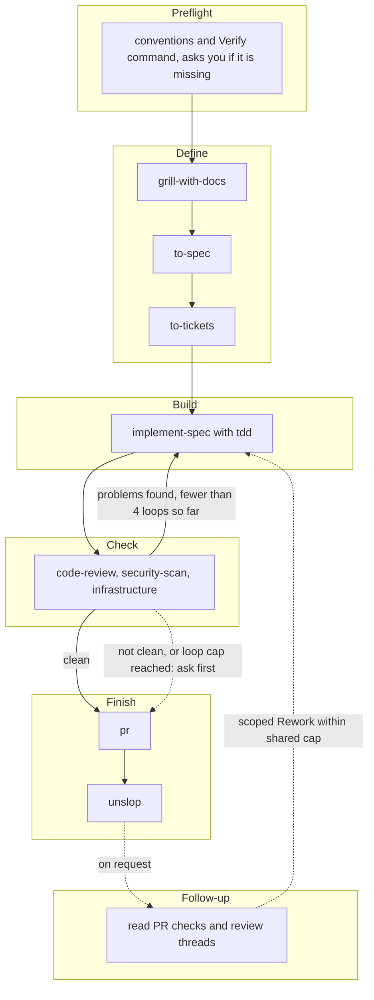

# TDS Factory

TDS Factory is a small software factory. It installs skills into Claude, Codex and Copilot. One of them, `factory`, takes a piece of work from idea to pull request.

New here? Read the [install guide](docs/install.md) to set the Factory up, then the [usage guide](docs/usage.md) to run your first piece of work. Before a first Run, run `tds-factory doctor` in the project. It checks whether the project is ready, for Claude, Codex and Copilot, and changes nothing.

## Setup

You need Node 20 or newer. One line installs the latest Release and its skills.

macOS and Linux:

```sh
curl -fsSL https://github.com/TDSchreur/tds-factory/releases/latest/download/install.sh | sh
```

Windows (PowerShell 7, `pwsh`; install it from https://aka.ms/powershell first if you do not have it):

```powershell
pwsh -c "irm https://github.com/TDSchreur/tds-factory/releases/latest/download/install.ps1 | iex"
```

Each script checks Node and npm, installs the Release with npm and runs `tds-factory install`. Run the same line again to update. To read the script before you run it, download and open it. You can also run the two commands yourself, the same on macOS, Linux and Windows:

```sh
npm install -g --allow-remote=root https://github.com/TDSchreur/tds-factory/releases/latest/download/tds-factory.tgz
tds-factory install
```

npm 12 refuses URL installs by default, so the command needs `--allow-remote=root`. `tds-factory --version` shows the installed version. Skills are not installed automatically by `npm install`. `tds-factory install` installs them, and you must run it again after every update, because the installed `factory` Skill must use the same Run commands as the CLI. `tds-factory update` and the one-line scripts do both steps.

To update, run `tds-factory update`. It installs the latest Release when yours is older and checks the download against the Release's checksum. Then it runs `tds-factory install --force`, which replaces agent files and skills you edited with the defaults. It also replaces any skill folder of the same name that `tds-factory` did not install. Use `tds-factory update --no-force` to keep them. The one-line scripts keep them too. Set `TDS_FACTORY_FORCE=1` to replace them, or `TDS_FACTORY_SKIP_SKILLS=1` to install only the CLI.

Maintainers publish Releases manually. See the [release guide](docs/releasing.md). To work on the Factory itself, see the [development guide](docs/development.md). The [install guide](docs/install.md) describes the install options (`--agent`, `--project`, `--force`, `--dry-run`).

## The flow

After Preflight (`tds-factory doctor` runs its checks), a Run follows five Stages, with Follow-up available after publication. Start it with the `factory` skill (`/factory`).



Work runs on the Full track by default. The Fast track is a lighter Flow for bug fixes and tiny changes: Define asks one confirmation (a bug goes through `diagnosing-bugs`), writes a one-paragraph Spec and cuts a single Ticket, and Check still requires Standards and Security. Define recommends it for a bug fix, a documentation or test-title change, or a diff of at most about five files without a new public interface, schema or dependency, and names the criterion. You choose the track, or confirm the recommendation; it is never applied silently. The track is recorded in `run.json`, shown on the Dashboard and splits `tds-factory run stats`.

Each Stage produces one result.

- Define writes a Spec in `docs/specs/` and a Ticket per task in the project's Issue tracker.
- Build finishes every Ticket test-first, with one commit each. It builds what the Ticket asks and names any smaller option in one line in `build.md`. After the last Ticket and after every Rework it works through an Exit checklist: the project's static checks, a term sweep (`tds-factory run sweep`), the required artifacts, a story trace, a security check and a self-check of its own diff.
- Check gives Standards, Spec, Security and Infrastructure verdicts from fresh read-only subagents. Infrastructure is skipped when no infrastructure file changed. Projects can add independent source or interactive reviews. Only Blocking findings send the Run back to Build; LOW and INFO items, code smells and style judgement are Left open and listed in the pull request.
- Finish opens the pull request.
- Follow-up reads PR feedback on request and sends scoped Rework through Build and Check.

Projects can add required review Skills for their own stack, UI or UX; see [project reviews](docs/project-reviews.md).

The rules for each Stage are in [`skills/factory/SKILL.md`](skills/factory/SKILL.md). Only a clean Check goes on to Finish without asking, on both tracks, and Check and Follow-up together send the Run back to Build at most four times.

Agents need `tds-factory` on PATH to create and update the Run record. The record is `run.json` in `.factory/runs/<id>/`, plus a Markdown summary per Stage. Every Run works in its own Run worktree in `.factory/worktrees/<run id>`, on a branch named after the Run id and cut from the freshly fetched default branch of `origin`. Agents in separate tabs therefore never share files. Run records always live in the main checkout, so one Dashboard shows every Run. The Factory does not install dependencies. Run the project's normal setup in the worktree.

The [capability matrix](docs/capabilities.md) lists the default models per Stage and what each Agent target guarantees. To see whether an agent follows the Flow, run the on-demand [agent evaluation](docs/evaluation.md).

## Dashboard

`tds-factory dashboard` serves every Run of the repository on 127.0.0.1, with one card per Run in a column per Stage. The [Dashboard guide](docs/dashboard.md) covers what it shows, which routes it serves and how to delete a Run.

Add `.factory/` to the `.gitignore` of any project you run the factory in.

## Skills

The skills come from three upstream sources.

- [mattpocock/skills](https://github.com/mattpocock/skills)
- [backnotprop/pstack](https://github.com/backnotprop/pstack/tree/main/skills/unslop), which provides `unslop`
- [github/awesome-copilot](https://github.com/github/awesome-copilot/tree/main/skills/security-review), which provides `security-scan` (its `security-review` skill, renamed)

The upstream repos are git submodules in `vendor/`. `skills/` holds committed copies of the skills the factory uses, so a change upstream shows up in a diff before it reaches you. See `docs/adr/0001-committed-skill-copies.md`.

## License

MIT, see [LICENSE](LICENSE). The skills come from other MIT projects. Their notices are in [THIRD-PARTY-NOTICES.md](THIRD-PARTY-NOTICES.md).

## Documentation

- [Install guide](docs/install.md). Set the Factory up and prepare a project.
- [Usage guide](docs/usage.md). Run a piece of work from idea to pull request.
- [Dashboard guide](docs/dashboard.md). The page that shows every Run.
- [Capability matrix](docs/capabilities.md). What each Agent target guarantees.
- [Agent evaluation](docs/evaluation.md). Test an agent against the Flow.
- [Development guide](docs/development.md). Work on the Factory itself from a checkout.
- [Release guide](docs/releasing.md). How maintainers publish a Release.
- [`GLOSSARY.md`](GLOSSARY.md). The terms used here (Run, Stage, Spec, Ticket and others).
- [`docs/adr/`](docs/adr/). Design decisions.
