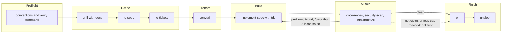

# TDS Factory

TDS Factory is a small software factory. It installs a set of skills into Claude, Codex and Copilot, and one of those skills, `factory`, walks a piece of work from idea to pull request.

**New here?** Read the [install guide](docs/install.md) to set the Factory up, then the [usage guide](docs/usage.md) to run your first piece of work.

It is inspired by [zazencodes software-factory-claude-code](https://github.com/zazencodes/zazencodes-season-3/tree/main/src/software-factory-claude-code) and [super-board](https://github.com/EricTechPro/super-board).

## The flow

A Run is one pass through five Stages, after a Preflight. Start it with the `factory` skill (`/factory`).



Each Stage's result: Define writes a Spec in `docs/specs/` and a Ticket per task in the project's Issue tracker; Prepare sets Build to build what was asked; Build finishes every Ticket test-first, one commit each; Check gives a Standards, a Spec, a Security and an Infrastructure verdict, each from a fresh read-only subagent; Finish opens the pull request.

The rules for each Stage live in [`skills/factory/SKILL.md`](skills/factory/SKILL.md). In short: only a clean Check goes on to Finish without asking, and Check sends the Run back to Build at most twice.

Agents need `tds-factory` on PATH to create and update the Run record (`run.json`, in `.factory/runs/<id>/`, plus a Markdown summary per Stage). Every Run works in its own Run worktree in `.factory/worktrees/<run id>`, on a branch named after the Run id, cut from the freshly fetched default branch of `origin`, so agents in separate tabs never share files. Run records always live in the main checkout, so one Dashboard shows every Run. Dependencies are not installed for you: run the project's normal setup in the worktree.

### Default models per Stage

`tds-factory install` writes four Stage agents per target (`factory-define`, `factory-build`, `factory-check`, `factory-finish`) next to the skills: `~/.claude/agents`, `~/.codex/agents` and `~/.copilot/agents` (`.github/agents` with `--project` for Copilot). Define and Prepare share `factory-define`. The main agent stays the coordinator: it talks to you, owns the Run record and approvals, and runs the Check reviews as three or four independent read-only agents. Each cell is model and reasoning effort; "default" means the session setting applies and "not set" means Copilot has no effort setting.

| Stage | Claude | Codex | Copilot |
|---|---|---|---|
| Define, Prepare | Sonnet, default | `gpt-6.1-sol`, medium | `claude-sonnet-4.6`, not set |
| Build | Sonnet, default | `gpt-6.1-terra`, medium | `gpt-5.3-codex`, not set |
| Check | Opus, high | `gpt-6.1-sol`, high | `claude-sonnet-4.6`, not set |
| Finish | Haiku, default | `gpt-6-luna`, medium | `claude-haiku-4.5`, not set |

Edit the agent files to change a model. Install keeps files that already exist; `--force` replaces them with the defaults. Whether a model is available depends on your client, account and policy, and the client may substitute another or not report which one ran; the Factory reports such cases instead of assuming. The defaults are verified for Copilot CLI only, not for other Copilot environments, and have not been checked against a live client.

## Setup

You need Node 20 or newer. Install the latest Release with one command, the same on macOS, Linux and Windows:

```sh
npm install -g --allow-remote=root https://github.com/TDSchreur/tds-factory/releases/latest/download/tds-factory.tgz
tds-factory install
```

The `--allow-remote=root` flag is needed because npm 12 refuses URL installs by default. Run the same `npm install` command again to update, then `tds-factory install` to refresh the skills. `tds-factory --version` shows the installed version. Skills are not installed automatically by `npm install`; you run `tds-factory install` yourself. Maintainers publish Releases manually; see the [release guide](docs/releasing.md).

### Working from a checkout

To work on the Factory itself, clone with `--recurse-submodules` (or run `git submodule update --init` afterwards). After a PR is merged, run `node scripts/dev-install.js`. It fetches `origin`, packs its default branch and installs that globally, so you use what is on `master` instead of the last Release. Your checkout and working tree are not touched. Then run `tds-factory install` to refresh the skills.

```sh
node bin/tds-factory.js sync       # copy the skills in skills.manifest.json from vendor/ into skills/
node bin/tds-factory.js install    # install skills/ into ~/.claude/skills and ~/.agents/skills
node bin/tds-factory.js dashboard  # serve the Runs of ./.factory on a per-repo port (printed at start)
```

`sync` validates every manifest entry (name, paths inside the repository, no symlinks, no duplicate names) before it writes any.

Run the tests with `npm test`. They use `node:test`.

### Install options

| Option | Effect |
|---|---|
| `--agent claude\|codex\|copilot\|all` | Pick the Agent target. `all` is the default and means Claude plus Codex, because Copilot reads both directories. |
| `--project` | Install into the current directory instead of the user-global directory. |
| `--force` | Overwrite skill folders that tds-factory did not install. |

| Agent | Project directory | Global directory |
|---|---|---|
| claude | `.claude/skills` | `~/.claude/skills` |
| codex | `.agents/skills` | `~/.agents/skills` |
| copilot | `.github/skills` | `~/.copilot/skills` |

After you change a skill in `skills/`, run `install` again so the installed copy matches. `install` also removes folders it installed earlier that are no longer in `skills/` (it prints a `removed` line for each) and never touches folders without the tds-factory marker.

## Dashboard

`dashboard` serves the `.factory/` folder of the main checkout of the current repository (from any subfolder or linked worktree) on 127.0.0.1 and can delete completed or abandoned Runs after confirmation. Deleting a Run also removes the Run worktree that `run start` created (not an adopted one) with a plain `git worktree remove`; if the worktree has uncommitted changes the removal is refused and the Run stays. Branches are never deleted. Without `--port`, each repository gets its own port (4300 to 4999, derived from the path of its main checkout), so Dashboards for several repositories run side by side and keep their URL across restarts. If that port is busy, the Dashboard takes a free one. `--port` uses exactly the port you give. It prints the URL when it starts.

The page is built with Preact and htm, committed in `dashboard/vendor/` (see `dashboard/vendor/README.md` for versions and how to update them) and loaded as ES modules, so there is no build step. See `docs/adr/0003-preact-htm-dashboard.md`.

| Route | Returns |
|---|---|
| `/` | The Dashboard page, with a card per Run in a column per Stage. Runs waiting on you are flagged. Check cards show a chip per verdict: Standards, Spec, Security and Infrastructure. |
| `/style.css`, `/app.js`, `/components.js`, `/model.js`, `/markdown.js`, `/vendor/preact.js`, `/vendor/hooks.js`, `/vendor/htm.js` | The Dashboard's stylesheet, ES modules and vendored libraries, from the `dashboard/` folder. Only these names are served. |
| `/api/views` | Run records interpreted for the Dashboard. |
| `/api/runs` | A JSON list of Run records. A record that cannot be read comes back with `unreadable: true`. |
| `/files/<run-id>/<name>.md` | A Markdown file from a Run folder. |

Add `.factory/` to the `.gitignore` of any project you run the factory in.

## Skills

The skills come from four upstream sources.

- [mattpocock/skills](https://github.com/mattpocock/skills)
- [DietrichGebert/ponytail](https://github.com/DietrichGebert/ponytail)
- [backnotprop/pstack](https://github.com/backnotprop/pstack/tree/main/skills/unslop), which provides `unslop`
- [github/awesome-copilot](https://github.com/github/awesome-copilot/tree/main/skills/security-review), which provides `security-scan` (its `security-review` skill, renamed)

The upstream repos are git submodules in `vendor/`. `skills/` holds committed copies of the skills the factory uses, so a change upstream shows up in a diff before it reaches you. See `docs/adr/0001-committed-skill-copies.md`.

## Known limitations

- The installer copies skills unchanged. Codex ignores the Claude-only `disable-model-invocation` frontmatter, so Codex may invoke user-only skills such as `factory` on its own.
- From ponytail, the installer copies only `SKILL.md`. Its hooks and slash commands are not installed.

## License

MIT, see [LICENSE](LICENSE). The skills come from other MIT projects; their notices are in [THIRD-PARTY-NOTICES.md](THIRD-PARTY-NOTICES.md).

## More

`GLOSSARY.md` defines the terms used here (Run, Stage, Spec, Ticket and others). Design decisions live in `docs/adr/`.
