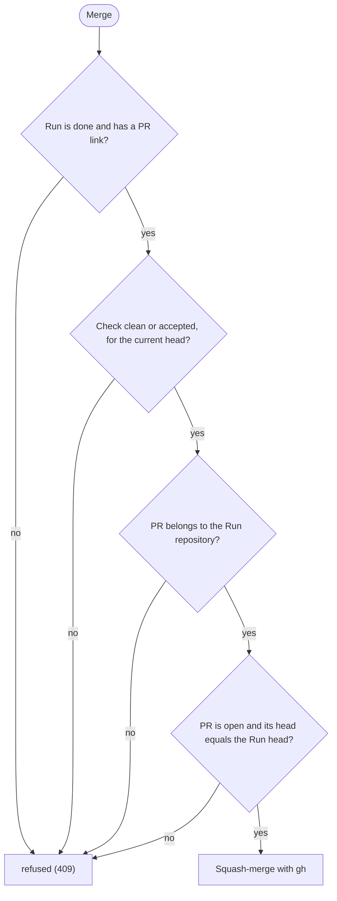

# The Dashboard

`tds-factory dashboard` serves the `.factory/` folder of the main checkout of the current repository (from any subfolder or linked worktree) on 127.0.0.1. Delete is available for individual Runs in every column. Stop the Run's agent before deleting an unfinished Run. Deletion removes the Run history and its Factory-created worktree, preserving its branch and linked Tickets, PRs and Specs. Adopted worktrees are left alone. If the worktree has uncommitted changes, including untracked files or changed submodules, a separate confirmation offers to permanently discard them and remove the worktree. Cancelling preserves the Run. Git or storage failures also preserve the Run and show the cause. Delete all is limited to Done Runs and asks separately about each dirty worktree.

Without `--port`, each repository gets its own port (4300 to 4999, derived from the path of its main checkout), so Dashboards for several repositories run side by side and keep their URL across restarts. If that port is busy, the Dashboard takes a free one. `--port` uses exactly the port you give. It prints the URL when it starts.

The page is built with Preact and htm, committed in `dashboard/vendor/` (see `dashboard/vendor/README.md` for versions and how to update them) and loaded as ES modules, so there is no build step. See `docs/adr/0003-preact-htm-dashboard.md`.

| Route | Returns |
|---|---|
| `/` | The Dashboard page, with a card per Run in a column per Stage. Runs waiting on you are flagged. Check cards show a chip per verdict: Standards, Spec, Security and Infrastructure. |
| `/style.css`, `/favicon.svg`, `/app.js`, `/components.js`, `/model.js`, `/markdown.js`, `/vendor/preact.js`, `/vendor/hooks.js`, `/vendor/htm.js` | The Dashboard's stylesheet, icon, ES modules and vendored libraries, from the `dashboard/` folder. Only these names are served. |
| `/api/views` | Run records interpreted for the Dashboard. |
| `/api/info` | The project folder the Dashboard serves. |
| `/api/runs` | A JSON list of Run records. A record that cannot be read comes back with `unreadable: true`. |
| `/files/<run-id>/<name>.md` | A Markdown file from a Run folder. |
| `DELETE /api/runs/<run-id>` | Deletes a Run. Dirty worktrees return HTTP 409 with `X-Factory-Error: dirty-worktree`. A separately confirmed `?discardChanges=true` discards changes. Same-origin requests only. |
| `GET /api/runs/<run-id>/merge-checks` | The GitHub checks of the Run's pull request. |
| `POST /api/runs/<run-id>/merge` | Squash-merges the Run's pull request. Same-origin requests only. |

## Merging from the Dashboard

The **Merge** button asks the server to merge the Run's pull request, and the server checks first:

If GitHub cannot be reached, returns no usable PR head, or `gh` cannot merge, the server answers 502 and merges nothing. An unknown Run gets 404, and a request from another origin gets 403.

For how to read the cards, see the [usage guide](usage.md#5-follow-runs-on-the-dashboard).

The browser tab is titled `<project folder> · TDS Factory`, with `(N) ` in front while N Runs wait on you, so several Dashboards are easy to tell apart. The Dashboard serves `/favicon.svg` as the tab icon.
