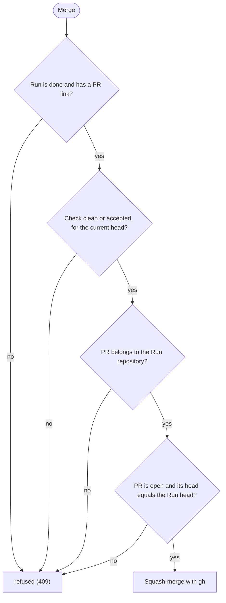

# The Dashboard

`tds-factory dashboard` serves the `.factory/` folder of the main checkout of the current repository (from any subfolder or linked worktree) on 127.0.0.1. Delete is available for individual Runs in every column. Stop the Run's agent before deleting an unfinished Run. Deletion removes the Run history and its Factory-created worktree, preserving its branch and linked Tickets, PRs and Specs. Adopted worktrees are left alone. If the worktree has uncommitted changes, including untracked files or changed submodules, a separate confirmation offers to permanently discard them and remove the worktree. Cancelling preserves the Run. Git or storage failures also preserve the Run and show the cause. Delete all is limited to Done Runs and asks separately about each dirty worktree.

Without `--port`, each repository gets its own port (4300 to 4999, derived from the path of its main checkout), so Dashboards for several repositories run side by side and keep their URL across restarts. If that port is busy, the Dashboard takes a free one. `--port` uses exactly the port you give. It prints the URL when it starts.

The header shows the serving Factory installation's version beside the logo, including when there are no Runs. This is the same version printed by that installation's `tds-factory --version`.

At widths up to 1024 CSS pixels, the Dashboard shows one Stage at a time. Use the Stage buttons to switch columns; each button shows the number of visible Runs and flags those waiting for you. The first view favors a waiting Run's Stage, then the first nonempty Stage. Your selection stays in place while the Dashboard refreshes or you change the older-Run filter. Wider screens show all six columns together.

Selecting a Run opens its detail across the screen at compact widths. Use **Back to stages** or Escape to return to the Run's card in its Stage. The Dashboard remains beside the detail on wider screens, where you can select another Run without closing it.

Each card carries a Fast or Full chip for its track (a Run without a track is Full), and Run detail shows it too, with Stage time, Reworks and first-pass clean rate using the same calculations as `tds-factory run stats --id ID`. Time includes waiting and repeated visits; an active visit is labeled ongoing. Old or missing observations show `no data`. Tokens and cost are `not tracked` for current Agent targets. See [Run metrics in the usage guide](usage.md#run-metrics) for the rate and totals.

## Help and the first run

The **Help** button in the header opens a help panel: a dialog with short sections on the Stages, the Fast and Full track, what "Needs you" means, the Check verdicts (pass, fail, skipped) and Left open, and the actions Merge, Sync, Clean up, Accept Check and Grant extra loop. The text is static (`dashboard/help.js`) and uses the glossary's terms. The focus moves into the panel, Tab stays inside it, Esc or **Close** closes it and the focus returns to what opened it. On narrow screens it fills the screen.

When there are no Runs at all, a welcome card replaces the Stage columns. It shows how to start (`/factory` and what you want built), says that the Run appears here, and has a **How does this work?** link that opens the help panel. The card goes away as soon as a Run exists, and it does not appear when the Needs you filter merely hides every Run.

## Design

The Dashboard follows Fluent 2 ([ADR 0025](adr/0025-the-dashboard-adopts-fluent-2-through-design-tokens.md)): neutral surfaces, a brand blue accent, 14 px type, 4 px corners and soft elevation. `dashboard/style.css` starts with a layer of Fluent design tokens, named as Fluent names them (`--colorNeutralBackground1`, `--fontSizeBase300`, `--shadow4`, ...), taken from `@fluentui/tokens` 1.0.0-alpha.24 (`webLightTheme` and `webDarkTheme`). Every rule below the layer uses only those tokens; a test checks that no rule uses a literal colour and that every token is used. No font is shipped: the font list starts with Segoe UI and continues with the system fonts. To update the tokens, follow ADR 0025.

- **Themes.** Light, dark and System work as before: the theme selector sets `data-theme`, and System follows `prefers-color-scheme`.
- **Contrast.** Every text and background pair keeps at least 4.5:1, and borders, focus rings and the progress fill keep 3:1, in both themes. A unit test computes this from the token values and a browser test measures the rendered text. Pass, fail, quiet and waiting states also say so in text and symbols, never by colour alone.
- **Focus.** Every control that can take keyboard focus shows a two-colour ring (an inner and an outer ring), so it shows on every surface in both themes.
- **Reduced motion.** With `prefers-reduced-motion: reduce` the Dashboard has no transitions or animations.
- **High contrast.** With forced colours (`forced-colors: active`) the browser uses your system colours. The progress fill, the status dot, the primary and pressed buttons (also when hovered or pressed), the selected card and the focus ring are redrawn in the system highlight colours, and a waiting card also gets a 3 px double border. An abandoned Run has a dashed card in a muted surface, not faded text, so its text keeps the same contrast.
- **Narrow screens.** Up to 1024 CSS pixels the Stage navigation and the full-screen detail work as before, with 44 px touch targets.

## Runs that wait on you

One definition of waiting is used everywhere: the Run's `waiting` flag in `/api/views`, which is true while its status is `waiting` or `waiting_on_human` is set and the Run is not done or abandoned. The card border, the banner, the filter, the sort, the tab title count and the browser notification all read it.

- A waiting card carries a banner that starts with a pause symbol and reads "Needs you, waiting 12 min: <reason>". The Run detail shows the same banner. It is text and a thick left border as well as colour.
- The wait age comes from the Run's event log: the latest waiting event, if nothing released the Run or changed its status after it. When the log cannot tell (an older Run, a damaged log or a wait older than the last 50 events), the banner shows no age and does not guess.
- The **Needs you (N)** button in the header filters every Stage to the Runs that wait on you. It is pressed while the filter is on, and a Stage without waiting Runs says so. The filter is not saved and does not change the tab title count.
- In each Stage, waiting Runs come first, the longest wait first.
- Paused Runs ("Verification unavailable", "Agent interrupted") keep their own line and are not waiting.

## Pull request status

A Run with a GitHub or Azure DevOps pull request in Finish, Follow-up or Done (and not abandoned) shows the status of that PR on its card and in its detail, read through the PR provider ([ADR 0020](adr/0020-pr-providers-sit-behind-one-seam.md)) with one `gh pr view` call, or for Azure DevOps with `az repos pr show` and `az repos pr policy list`:

- The link to the pull request (on a card that is not Done; a Done card has its own link).
- For an open PR: **Checks** (passing, pending, none reported, or failing with the names of up to five failing checks), **Merge** (no conflicts, conflicts with the base branch, or unknown, which GitHub says while it still works it out), **Review** (approved, changes requested, review required, none yet) and **Draft**. A failing check and a conflict are also marked in colour, but always say so in text.
- A merged or closed PR shows no status lines: the state badge says it.

The status never delays the board. `/api/views` answers from a cache per PR link and starts the lookup in the background; the card says "PR status: checking..." until the first answer. An open PR is read again after a minute, a merged or closed one after ten minutes, and a failed lookup after half a minute. When `gh` or `az` cannot answer, the card says "PR status unavailable" with the reason and the fix (`gh` or `az` not installed, the Azure DevOps extension missing (`az extension add --name azure-devops`), not signed in (`gh auth login` or `az login`), rate limit reached, or the host could not be read) and a **Check again** button, which reads the status from GitHub again. The rest of the board is unaffected. The Merge action and its checks do not use this status and are unchanged.

### Azure DevOps

An Azure DevOps link has the form `https://dev.azure.com/<organisation>/<project>/_git/<repository>/pullrequest/<id>` (the older `visualstudio.com` form is not supported). The Azure CLI with its `azure-devops` extension and a signed-in user (`az login`) are needed, and every call only reads. The same lines are shown, taken from the PR and its policies:

- **Checks** are the blocking policies that are not about reviewers (build validation, comment requirements, status checks): a rejected or broken one is failing and is named, a running or queued one is pending.
- **Merge** is conflicts when Azure DevOps reports a merge conflict.
- **Review** is changes requested when a reviewer voted "rejected" or "waiting for the author", review required while a required reviewer has not voted or a reviewers policy is not met (a creator's own vote does not count unless the policy allows it), approved when someone approved.
- The Done Stage shows the PR as open, merged (completed) or closed (abandoned), and Clean up works after it is merged.
- **Merge** is not offered: an open Azure DevOps PR in Done shows "Merge it in Azure DevOps" instead of the button, the Merge route answers 409, and Follow-up refuses an Azure DevOps PR with "Follow-up does not support Azure DevOps yet".

The Factory never writes to Azure DevOps. The tests use output recorded from the sandbox repository `Kahoot` (`test/fixtures/pr-status/azure/`) and never call `az`.

## Progress on cards and in the Run detail

A card that is not Done shows how far the Run is, from the data in `/api/views` ([ADR 0021](adr/0021-run-record-model-last-seen-and-event-log.md)):

- A Ticket progress bar, when the Run has Tickets, with the finished and total count for screen readers.
- The activity line the agent last set.
- The model line. A model the Factory asked for reads "Model (requested): X, effort Y". Only a model the agent reported itself reads "Model (observed): X", with the requested one as its tooltip. Nothing is shown when no model is known.
- "Last seen N min ago", from the Run's `last_seen`. For a running Run it turns into a warning ("⚠ ... quiet", in text as well as colour) after 10 minutes. A Run that waits on you, is paused, finished or abandoned is never warned. A Run without `last_seen` shows no last-seen text.

The Run detail lists the Run's event log as a timeline, oldest first, with relative times: Stage changes, Tickets done, Verify start and result with its duration, waiting and release, other status changes and Reworks. When some lines of the log could not be read, a note above the timeline says how many, since the timeline is then incomplete. A Run without any of this data, such as one from an older version, shows none of these parts and nothing in their place.

The page is built with Preact and htm, committed in `dashboard/vendor/` (see `dashboard/vendor/README.md` for versions and how to update them) and loaded as ES modules, so there is no build step. See `docs/adr/0003-preact-htm-dashboard.md`.

| Route | Returns |
|---|---|
| `/` | The Dashboard page, with a card per Run in a column per Stage. Runs waiting on you are flagged. Cards show the track, and Check cards a chip per verdict: Standards, Spec, Security and Infrastructure (Spec may be skipped on the Fast track). Cards carry the [actions](#actions). |
| `/style.css`, `/favicon.svg`, `/app.js`, `/components.js`, `/model.js`, `/markdown.js`, `/help.js`, `/vendor/preact.js`, `/vendor/hooks.js`, `/vendor/htm.js` | The Dashboard's stylesheet, icon, ES modules and vendored libraries, from the `dashboard/` folder. Only these names are served. |
| `/api/views` | Run records interpreted for the Dashboard, including `model` (`requested`, `effort` and `observed`, each empty when unknown; a requested model is not a confirmed one), `lastSeen`, the last 50 `events` of the Run's event log and `eventsDamaged`, the count of log lines that could not be read. |
| `/api/info` | The project folder the Dashboard serves, the session token for write routes and, when available, the serving Factory package version. |
| `/api/runs` | A JSON list of Run records, each with its raw event log (`events`). Use `/api/views` for the interpreted data. A record that cannot be read comes back with `unreadable: true`. |
| `/files/<run-id>/<name>.md` | A Markdown file from a Run folder. |
| `DELETE /api/runs/<run-id>` | Deletes a Run. Dirty worktrees return HTTP 409 with `X-Factory-Error: dirty-worktree`. A separately confirmed `?discardChanges=true` discards changes. A write route: see [Write routes](#write-routes). |
| `GET /api/runs/<run-id>/merge-checks` | The GitHub checks of the Run's pull request (409 for a host without them, such as Azure DevOps). |
| `GET /api/runs/<run-id>/pr-status[?refresh=1]` | The [PR status](#pull-request-status) of the Run's pull request as JSON: `{ checking: true }`, `{ unavailable: <reason> }` or the status. `?refresh=1` asks GitHub again instead of the cache, but not more often than every five seconds per PR. HTTP 409 for a Run that has no PR status. A read: it changes nothing and needs no session token. |
| `POST /api/runs/<run-id>/merge` | Squash-merges the Run's pull request. A write route. |
| `POST /api/runs/<run-id>/sync` | Runs `tds-factory run sync` for the Run: rebases its branch onto the default branch of `origin`. A refusal (a Run that is not running, uncommitted changes, a rebase already in progress, a conflict, a Run outside Build and Check) is HTTP 409 with the message. A write route. |
| `POST /api/runs/<run-id>/clean` | Runs `tds-factory run clean` for the Run from the main checkout. A Run that is kept (PR not merged, uncommitted changes, extra commits) is HTTP 409 with the reason. A write route. |
| `POST /api/runs/<run-id>/extra-loop` | Grants one extra Check loop to a Run in Check that waits on you at its loop limit, with `?updated=` naming the Run record time the page showed (a changed Run is HTTP 409). A refusal is HTTP 409 with the reason. A write route. |
| `POST /api/runs/<run-id>/accept` | Accepts a Check that is not clean for the Run's current head. Only for a Run in Check that waits on you, with `?updated=` naming the Run record time the page showed (a changed Run is refused), and refused with HTTP 409 when the Check is already clean or accepted. A write route. |

## Actions

Cards carry buttons for the Dashboard actions. Each asks for confirmation, then shows the result or the reason it was refused.

- **Sync** appears on running Runs in Build and Check (a Run waiting on you, or paused, cannot change until it runs again). It rebases the Run branch onto the current default branch of `origin`. If the code or the base changes, the Evidence is cleared.
- **Accept Check** appears on a Check that waits on you. The confirmation lists the four verdicts. It records that you continue to Finish with a Check that is not clean, for the current code only; a new commit voids it. The Run is released from waiting. Then tell the agent in its chat that you accepted: it finds the decision recorded for the current head and moves on to Finish.
- **Grant extra loop** appears on a Run in Check that waits on you after it has used all its Check loops (four, or the lower cap the project set). The confirmation says what it does. One click allows one more Rework and raises the limit by one (the chip then reads, for example, "loop 4/5"); there is no ceiling, and you can grant another loop each time the Run waits at its limit again. The Run is released from waiting. Then tell the agent in its chat that you granted it: it sees the raised limit as your decision to go back to Build and does not ask again about Finish. The grant is in the Run record (`extra_loops`) and in the timeline. Only this button grants a loop: there is no command-line equivalent, and an agent cannot raise the limit with `run update`. As with Accept Check, the session token keeps other web pages out, but cannot stop an agent that reads the token from `/api/info` ([ADR 0024](adr/0024-the-user-can-grant-an-extra-check-loop.md)).
- **Clean up** appears on a Done Run whose pull request is merged. It removes the Run worktree and branch and keeps the Run record.

Starting a Run stays in the agent: the Dashboard cannot start, resume, rework or complete a Run.

### Needs you notification

When a Run starts waiting on you while the Dashboard is open, the browser shows a notification, `Needs you: <title>`, with the reason. Runs that already wait when you open the page only count in the tab title. Press **Notify me** in the header to let the browser ask for permission; the button disappears once you have answered. Without notifications, the `(N)` in the tab title still shows how many Runs wait on you.

## Write routes

Every route that changes something (`DELETE` and `POST`) passes one guard before it does anything, and a request that fails it gets HTTP 403:

- the `Host` header is `127.0.0.1:<port>` or `localhost:<port>` (this applies to every route);
- the `Origin` header equals `http://<Host>`, so only this Dashboard page can write;
- the `X-Factory-Token` header holds the session token. The server makes the token when it starts and the page reads it from `/api/info`. It changes on every start, so reload an open page after restarting the Dashboard.

The server sends no CORS headers and answers no preflight. See [ADR 0017](adr/0017-dashboard-write-routes-need-origin-host-and-a-session-token.md).

## Merging from the Dashboard

The **Merge** button asks the server to merge the Run's pull request, and the server checks first:

If GitHub cannot be reached, returns no usable PR head, or `gh` cannot merge, the server answers 502 and merges nothing. An unknown Run gets 404, and a write without the page's Origin and session token gets 403 (see [Write routes](#write-routes)).

For how to read the cards, see the [usage guide](usage.md#5-follow-runs-on-the-dashboard).

The browser tab is titled `<project folder> · TDS Factory`, with `(N) ` in front while N Runs wait on you, so several Dashboards are easy to tell apart. The Dashboard serves `/favicon.svg` as the tab icon.
