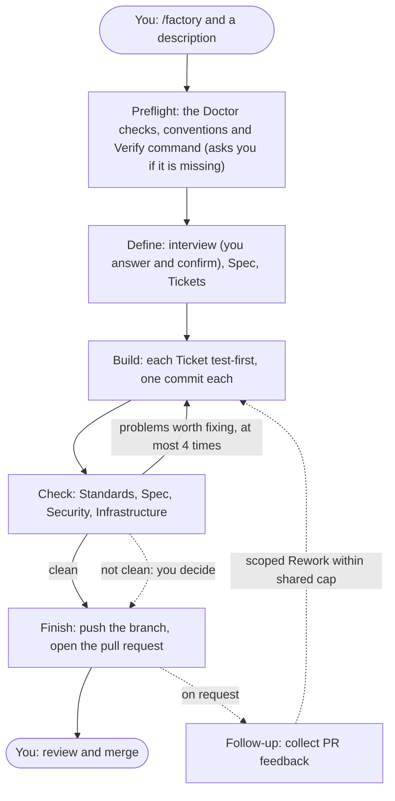
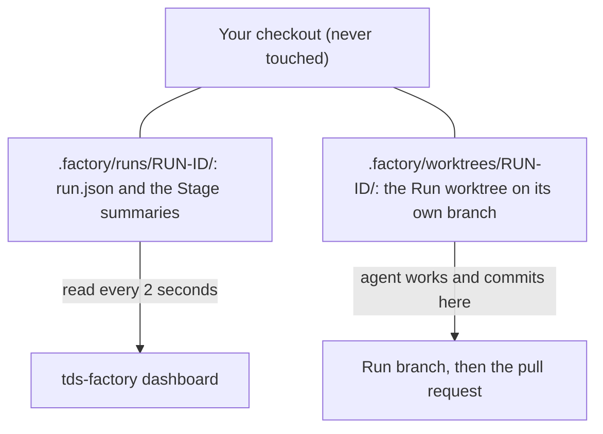
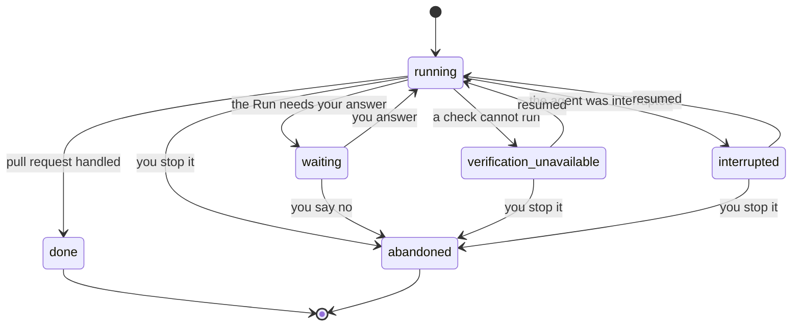

# Use the Factory

This guide walks through one piece of work, from the first message to the merged pull request. Install the Factory first: [install guide](install.md). The examples use GitHub Copilot; Claude Code and Codex work the same way once the agent has found the skill.

## The Flow in one picture



The Run waits for you in Define, in Preflight when the Verify command is missing, and at the dotted line from Check.

Define is where the agent needs you most. After that it works on its own and stops only for a missing label or a Check that is not clean (see part 4).

## 1. Start a Run

Before the first Run in a project, check that it is ready. From the project folder:

```sh
tds-factory doctor
```

It changes nothing and prints one line per check, such as `pass    git: origin default branch is main`. Fix every line that says `missing` or `fail` first; `/factory` runs the same checks and stops when one fails. See "Check readiness without starting a Run" below for what it checks.

Open your prepared project (see part 5 of the [install guide](install.md)) in your agent and start a new chat. Describe the work in the same message that starts the skill:

```text
/factory Add a CSV export button to the reports page
```

In Copilot in VS Code, type `/`, choose `factory`, and write the description after it. In Claude Code, type `/factory` and the description. In other agents, choose `factory` from the agent's own list of skills and write the description in the same message. Any agent can also start `factory` on its own when you describe a feature end to end. Typing `/factory` starts a Run on purpose.

Start with a small task the first time. Good first tasks change one thing and are easy to check, such as a new button, a validation rule or a missing test.

The agent first runs `tds-factory doctor` and, if something is missing, stops and tells you which part. Then it starts a Run (if the project has no verify command yet, it asks you for one, see part 4): it makes a git worktree in `.factory/worktrees/<run id>` on its own branch and does all the work there. Your own checkout is never touched, so you can keep working in it, and you can run several Runs side by side.



## 2. Define: answer the questions

Work on a Run is on the Full track unless you choose the Fast track. The Fast track is for bug fixes and tiny changes. Say "fast track" when you start the Run, or let Define recommend it and answer yes; the Factory never applies it silently. On the Fast track Define skips the interview: for a bug the agent first diagnoses the cause with `diagnosing-bugs`, then asks you one confirmation of what it understood, the one-paragraph Spec and the single Ticket. Build makes one commit, and Check still requires Standards and Security (the Spec review may be skipped). The rule is unchanged: only a clean Check goes on to Finish without asking. The rest of this section describes the Full track.

The agent interviews you to settle what has to be done. It asks in rounds. Each question is numbered and comes with the answer the agent recommends, written so that "yes" accepts it. An example:

```text
Q1 - Format: export plain CSV, not Excel?
-> Yes, plain CSV. It opens in Excel and needs no library.
```

- Answer a question by number. "Yes to all" accepts every recommendation in the round.
- Say so when you disagree. The agent changes the plan and asks the next round.
- The agent may update `GLOSSARY.md` and add a decision record in `docs/adr/` while you talk. Those are normal files and show up in the pull request.
- When nothing is left to ask, the agent tells you what it understood and waits for you to confirm. Read that summary carefully. Changes are cheap now and expensive after Build.

The agent then writes a Spec in `docs/specs/`, and cuts it into Tickets in GitHub Issues, without asking you to approve either. Each Ticket is a small slice that can be built and checked alone.

## 3. What happens without you

- **Build:** the agent writes a failing test, makes it pass, runs the project's verify command and commits, one Ticket at a time. After the last Ticket and after every Rework it works through an Exit checklist (a term sweep, the required artifacts, a story trace, a security check and a self-check of its own diff), so that Check finds less to send back.
- **Check:** the Factory asks for four baseline reviews separately (three when no infrastructure file changed), each in a fresh read-only subagent that did not write the code. Projects may add source or interactive reviews, each with its own independent reviewer. How your agent runs subagents is up to the agent; the Factory does not control it. Standards: does the code follow the project's rules. Spec: does it do what the Spec asked. Security: does it introduce a vulnerability. Infrastructure: are Bicep and pipeline files valid (skipped when none changed). Problems worth fixing send the Run back to Build, at most four times.
- **Finish:** the agent writes the pull request, pushes the branch and opens it. Its description lists `Closes #N` for every Ticket.
- **Follow-up:** on request, `tds-factory run follow-up --id ID` reads failing CI and unresolved review threads and starts scoped Rework under the shared four-loop limit. New code needs fresh Verify and Check Evidence. Clean or pending feedback stays in Follow-up; a merged PR ends Done.

Most Stages leave a short summary in `.factory/runs/<run id>/`: `define.md`, `build.md`, `check-1.md` (one per Check pass), `finish.md`, `follow-up-N.md` for each observation and the pull request text in `pr.md`. `run.json` in the same folder is the status file the Dashboard reads. Read the summaries when you want to know what was decided.

## 4. When the Run needs you

A Run stops and asks you in these cases:

1. **During Define,** with questions or to confirm the shared understanding.
2. **At the start,** if the project has no verify command (see below). **Before Build,** if a label the Tickets need does not exist: the agent asks before it creates the label.
3. **After Check,** when a review still fails or problems are still open after four rounds of fixes. The agent lists the open findings and asks permission to continue. Say yes to open the pull request anyway (your decision is recorded in the Run and in `finish.md`, and only holds for the code as it is then; new commits void it), or no to abandon the Run.

A Run's `status` moves like this:



(`verification_unavailable` is `verification-unavailable` in `run.json`; Mermaid does not allow the hyphen.)

The same moment shows on the Dashboard as a red card marked "Needs you" and a number in the browser tab title. Answer in the chat where the agent is waiting. If you press **Accept Check** on the Dashboard instead, also tell the agent in the chat; it sees the recorded decision for the current code and continues.

If the project does not have a verify command in `AGENTS.md` (or `CLAUDE.md`) under `## Commands`, the agent asks for it once, at the very start of the Run, and records it. The command cannot be changed later; start a new Run for that. The Run shows as "Needs you" while it waits.

## 5. Follow Runs on the Dashboard

Start the Dashboard from the project folder:

```sh
tds-factory dashboard
```

It prints an address such as `http://127.0.0.1:4521`. Each repository gets its own port, and normally keeps it; if that port is busy, the Dashboard takes a free one and prints it. Open the address in a browser.

- Each **card** is one Run. It moves left to right through the columns Define, Build, Check, Finish, Follow-up and Done.
- On screens up to 1024 CSS pixels wide, use the Stage buttons to show one column at a time. The buttons show visible Run counts and mark Stages with Runs that need you.
- The **chips** show the Ticket progress, baseline and project Check verdicts (pass, fail, skipped) and how many times Check sent the Run back to Build.
- A card marked **Needs you** is waiting for your answer. **Verification unavailable** means the check could not run; **Agent interrupted** means the Run needs explicit resumption. Both cards show the reason.
- Click a card to open the **Run detail** with its links, Tickets, Stage summaries and Run metrics. On compact screens it fills the screen; use **Back to stages** or Esc to return to the same Run. On wider screens it opens on the right; click the card again, press Esc or use the close button to close it.
- Done cards start collapsed. Press **Show details** on a Done card to see its pull request link and actions. **Merge** appears while the pull request is open and squash-merges it after you confirm. **Clean up** appears once the pull request is merged and removes the Run worktree and branch. **Sync** (Build and Check) rebases the Run onto the default branch of `origin`, and **Accept Check** (a Check waiting on you) continues to Finish with a Check that is not clean. Each asks first. Press **Notify me** to get a browser notification when a Run starts waiting on you. **Delete** is available on every Run. Stop an unfinished Run's agent first. Delete removes its record and Factory-created worktree while keeping the branch. If the worktree has uncommitted changes, a separate confirmation lets you discard them or cancel. **Delete all** applies only to Done Runs and asks separately about each dirty worktree.
- Older Runs are folded away; "Show older" brings them back.

Leave the Dashboard open while you work. It refreshes every two seconds. The routes, the actions and the rules for deleting a Run are in the [Dashboard guide](dashboard.md).

### Run metrics

The Run record keeps the track (`fast` or `full`; a Run without one is Full). It shows as a Fast or Full chip on the card and in Run detail, and `tds-factory run stats --all` adds totals per track.

Run `tds-factory run stats --id ID` for one Run or `tds-factory run stats --all` for every Run and observed totals. Run detail shows the same per-Run summary. Stage time is elapsed wall-clock time, including waiting. Repeated visits are summed, and an open visit is labeled ongoing. Completion or abandonment stops the clock. A missing observation is `no data`; totals report observed values and identify missing or unreadable records.

First-pass clean rate is clean first Checks divided by observed first Check outcomes. Rework and an Accepted nonclean Check count as unsuccessful; unfinished and unknown outcomes are excluded. The output shows the numerator and denominator, or `no data` when there are no outcomes. The Run record keeps prior Check verdicts for history; they do not count as current Evidence. Current Agent targets expose no token or cost measurements to the Factory, so both are reported as `not tracked`.

## 6. Stop or redirect a Run

- **Stop:** tell the agent to stop. The Run is marked abandoned and stays on the Dashboard until you delete it.
- **Redirect:** tell the agent what to change in the chat. During Define it changes the plan. During Build or Check, ask for the change and expect it to be made in the Run worktree, on the Run branch.
- **Start over:** abandon the Run and start `/factory` again with a better description.

## 7. Review and merge the pull request

The agent opens the pull request but does not merge it. Before you merge:

1. Read the **Summary**: does it match what you asked for?
2. Read **Evidence**: which tests failed before and pass now.
3. Read **Merge Danger**: whether the change is easy to undo, and what it can break.
4. Open `check-1.md` (or the highest `check-N.md`) in the Run folder to see the baseline and project verdicts and any finding left open.
5. Look at the diff yourself, like any other pull request.

Merge in GitHub, or press **Merge** on the Dashboard card. The `Closes #N` lines close the Tickets. Then [clean up the Run's worktree and branch](#clean-up-after-a-merge). Maintainers who publish the merged work as a Release follow the [release guide](releasing.md).

## Words you will see

| Word | Meaning |
|---|---|
| Run | One pass of the Flow for one piece of work, from idea to pull request. One card on the Dashboard. |
| Track | The weight of the Flow: Fast (bug fixes and tiny changes: one confirmation, a one-paragraph Spec, one Ticket) or Full (the default). You choose it, or confirm Define's recommendation. |
| Stage | One step of the Flow: Define, Build, Check, Finish or Follow-up. |
| Spec | The written definition of what to build, a Markdown file in `docs/specs/`. |
| Ticket | One small unit of work cut from the Spec, an issue in GitHub. |
| Check axis | One of the independent reviews in Check: Standards, Spec, Security, Infrastructure. |
| Clean | A Check where every applicable axis passes (Infrastructure and nonmatching project reviews may be skipped) and the verify command passed, all for the current code with nothing uncommitted. Only a clean Check goes on without asking you. |
| Doctor | The read-only `tds-factory doctor` command that checks whether a project is ready for a Run. |
| Run worktree | The git worktree and branch a Run works in, so Runs never share files. |
| Run detail | The panel on the Dashboard that shows a Run's links, Tickets and Stage summaries. |

The full list is in [GLOSSARY.md](../GLOSSARY.md). What each Agent target guarantees, such as how read-only the Check agents are, is in the [capability matrix](capabilities.md). To test an agent against the Flow, see the [agent evaluation](evaluation.md).

## Check readiness without starting a Run

Run `tds-factory doctor [--agent claude|codex|copilot] [--json]` in the project. It changes nothing and reports `pass`, `missing` or `fail` for the CLI version, the required Skills, the tracker setup, the Git `origin` and its default branch, the optional `.factory/config.json` (a bad setting fails with the line to fix), the review capabilities (the review Skills and the read-only `factory-check` agent) and the verify command. For Copilot it also counts Skills in the Claude and Codex folders (`.claude/skills`, `.agents/skills` and their `~/` versions), where the default `install` puts them. It exits with 1 until every check passes. `/factory` runs it first; a missing verify command is the one thing the agent asks you for, and a Run without a usable one cannot enter Build, Check or Finish. Doctor also prints a `note` (and a `notes` list with `--json`) when merged Runs still hold a worktree or branch; a note never makes it fail.

## Keep a Run up to date

A Run branches from `origin`'s default branch when it starts, and the default branch moves while you work. `tds-factory run sync --id ID` fetches it and rebases the Run branch on top, in Build or Check. The `factory` Skill runs it before Check. If the rebase conflicts, the command names the files and leaves the branch unchanged; run `git rebase` with the commit it prints in the Run worktree, fix each conflicted file, `git add` it, run `git rebase --continue`, then run `run sync` again so the new base is recorded. `run sync` refuses to start while a rebase is already open in the worktree. A sync that changes the head or recorded base clears the Evidence, so verify and review again. Moving a Run to Finish is refused while the branch would not merge cleanly into the default branch, so you find conflicts before the PR exists. A base that moved without a conflict does not stop Finish.

## Clean up after a merge

A Run keeps its worktree and branch until you remove them. After the pull request is merged, run `tds-factory run clean --id ID` (or `run clean --all` for every Run) in your main checkout, not inside the Run worktree. It removes the worktree and the local branch of a Run whose PR GitHub reports as merged, and keeps the Run record and its summaries so the Dashboard still shows it. It deletes the worktree folder as a whole, so ignored files in it (a copied `.env`, notes) go too; copy out anything you want first. It leaves a Run alone, and says why, when it is not done yet (run `run complete` first), the PR is not merged, the worktree has uncommitted changes, a submodule holds commits or stashes that no remote has, or the branch has commits that are not in the merged PR. GitHub deletes the remote branch on merge when that repository setting is on.

## Recover a Run

Run `tds-factory run inspect --id ID` to diagnose its lock, worktree and stale Evidence. `tds-factory run repair --id ID` prints a proposal without changing anything. Review it, then add `--apply` to apply the safe changes. Repair checks the Run branch and GitHub PR before suggesting changes, keeps dirty worktrees, and reconstructs a missing record as interrupted. It clears only a lock whose local owner is known to have exited; age never expires a lock. An unknown or foreign owner must be investigated manually. A leftover repair coordination lock is also reported for manual investigation.

## Add project reviews

Projects can extend Check with source, UI or UX review Skills. Use the `add-project-review` Skill and see the [project review guide](project-reviews.md) for configuration, browser prerequisites and examples. Project review results participate in Rework and the Finish gate; each Run keeps its original configuration and Skill snapshot.

## Set project options

Put the project's settings in a committed `.factory/config.json`; every key is optional.

```json
{
  "models": { "build": "gpt-5.3-codex", "check": "claude-sonnet-5.5" },
  "max_check_loops": 2,
  "labels": { "ticket": "ready-for-agent" },
  "reviews": []
}
```

- `models` names a model per Stage (`define`, `build`, `check`, `finish`, `follow-up`) or for `interactive-check`. The coordinator passes it when it dispatches the Stage agent, so you do not edit agent files or run `install --force`.
- `max_check_loops` lowers how many times Check or Follow-up may send a Run back to Build. The Factory maximum is 4; a higher value fails.
- `labels.ticket` is the label `to-tickets` puts on Tickets.
- `reviews` holds [Project reviews](project-reviews.md), with the same entries as `.factory/reviews.json`, which keeps working.

`.factory/` is ignored for Run records, so commit the file with `git add -f .factory/config.json`. A Run reads it from the default branch of `origin` and freezes it when it starts; `tds-factory run config --id <id>` prints what it froze. Edits apply to new Runs. `tds-factory doctor` reports a bad value as `fail` with the line to fix. See [ADR 0016](adr/0016-project-config-is-committed-and-frozen-per-run.md).
